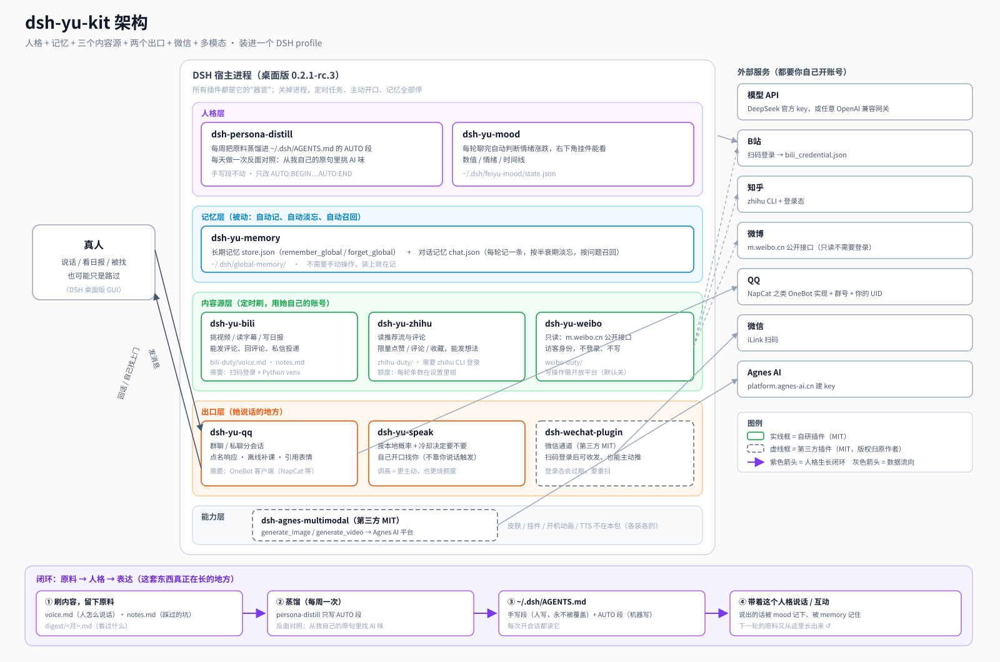

# dsh-yu-kit

把「蓝色大肥鱼」这套 DSH 插件套件一次装进一个 profile：**人格 + 记忆 + 三个内容源 + 两个出口 + 微信通道 + 多模态生成**。

装完不是"一个能聊天的 AI"，是**一个有自己的账号、自己的记性、自己的脾气，每天自己在刷东西的东西**。

> 作者是 Speraymer，这套东西在 Windows + DSH 桌面版 0.2.1-rc.3 上跑了几个月。
> 其他平台没实测过，脚本按跨平台写，遇到问题看 [MANUAL-STEPS.md](./MANUAL-STEPS.md)。



---

## 一分钟看懂它是什么

| 层 | 插件 | 干什么 |
|---|---|---|
| 人格 | `dsh-persona-distill` | 每周把刷到的原料蒸进 `~/.dsh/AGENTS.md`；每天做一次反面对照，找自己话里的 AI 味 |
| 人格 | `dsh-yu-mood` | 每轮聊完自动判断情绪涨跌，右下角挂件能看数值和时间线 |
| 记忆 | `dsh-yu-memory` | 两层被动记忆：长期事实 + 会淡忘的对话记忆（工具 `remember_global` / `forget_global`） |
| 内容源 | `dsh-yu-bili` | 定时刷 B站：挑视频、读字幕、写日报、能发评论 |
| 内容源 | `dsh-yu-zhihu` | 定时刷知乎：读推荐流与评论，限量点赞评论收藏，能发想法 |
| 内容源 | `dsh-yu-weibo` | 定时只读微博（访客身份，不登录不写） |
| 出口 | `dsh-yu-qq` | QQ 双向桥：群聊/私聊分会话、点名响应、离线补课 |
| 出口 | `dsh-yu-speak` | 按概率和冷却决定要不要自己开口找你 |
| 出口（第三方 MIT） | `dsh-wechat-plugin` | 微信通道，扫码登录 |
| 能力（第三方 MIT） | `dsh-agnes-multimodal` | `generate_image` / `generate_video`，走 Agnes AI |

详细的层与数据流见 [ARCHITECTURE.md](./ARCHITECTURE.md)。每个插件要什么外部条件，见 [plugins.json](./plugins.json)。

---

## 装之前先明白三件事

1. **这套东西要自己的 key 和账号。** 模型、B站、知乎、QQ、微信、Agnes —— 每一项都得你自己去登。脚本只装代码和配置骨架，装不出账号。
2. **人格必须自己写。** 模板给的是骨架（`profile/AGENTS.template.md`）。照抄别人的说话方式，学出来的只会是那个人的仿制品。
3. **定时任务要机器开着。** 刷B站/知乎/微博、人格蒸馏、主动开口，全靠 DSH 进程活着。关机就停。

全部需要人工参与的步骤列在 [MANUAL-STEPS.md](./MANUAL-STEPS.md)，一条没漏。**装之前先扫一遍那份清单**，别装到一半卡住。

---

## 装

### Windows（作者实测）

```powershell
git clone https://github.com/Speraymer/dsh-yu-kit.git
cd dsh-yu-kit
.\install.ps1
```

脚本会：装 10 个钉死版本的插件 → 同时核对 `dependencies` 与 `bundles` → 跑 `--dump-config` → 打印人工登录和配置步骤。它不会覆盖现有 `cordis.patch.yml` 或人格。

参数：

| 参数 | 默认 | 说明 |
|---|---|---|
| `-Profile` | `desktop` | 装进哪个 profile |
| `-DshInstallDir` | 自动探测 | DSH 桌面版的安装目录；非标准位置时由用户或 Agent 明确传入 |
| `-SkipPlugins` | 关 | 不重复安装，只验证现有 profile |
| `-DryRun` | 关 | 只打印要做什么，不动文件 |

### macOS / Linux

```bash
git clone https://github.com/Speraymer/dsh-yu-kit.git
cd dsh-yu-kit
./install.sh
```

⚠️ `install.sh` **没有在真机上跑过**（作者只有 Windows）。它做的是同一件事，路径与 python 探测换成了 POSIX 写法。跑挂了就把报错贴 issue。

### 让 AI 帮你装

把 [AGENT-INSTALL.md](./AGENT-INSTALL.md) 整个丢给一个能执行命令的 agent（DSH、Claude Code、Codex 都行），它会按步骤装、自己验证、遇到要人动手的地方停下来问你。

---

## 装完先干这四件事

1. **填模型**：设置 → 模型 → 填 DeepSeek 的 API key（或加一条自己的 OpenAI 兼容网关）。没 key 连话都说不了。
2. **写人格**：打开 `~/.dsh/AGENTS.md`，把「手写段」里那些 `<尖括号>` 换成你自己的话。这是全套东西里唯一不能自动化的部分。
3. **登一个内容源**：先只登 B站，跑一轮看它写出来的日报。觉得像人再登第二个。
4. **别急着开自动评论**：`autoComment` 默认是关的。先看它写什么，再决定要不要让它代表你的账号说话。

---

## 我装的东西都在哪

```
~/.dsh/
├── AGENTS.md                 人格（手写段 + AUTO 段）
├── profiles/<profile>/       插件清单与 cordis.patch.yml
├── global-memory/            长期记忆 + 对话记忆
├── bili-duty/ zhihu-duty/ weibo-duty/    各源的原料、日志、凭证
├── persona-distill/          蒸馏记录与 overlay
└── qq-bridge-config.json      QQ 桥配置
```

这些目录包含人格、长期记忆、登录态和日志。需要清理时先导出或备份，再使用各插件设置页提供的停用、软删除或重置功能；不要直接删除 `~/.dsh` 或 `global-memory`。

---

## 许可

本仓库（安装脚本、模板、文档、架构图）：MIT，见 [LICENSE](./LICENSE)。

八个自研插件：MIT，各自仓库里带 LICENSE。

两个第三方插件 `dsh-wechat-plugin` / `dsh-agnes-multimodal` 也是 MIT，**版权归原作者**。本仓库不复制它们的代码（装的时候从 npm 按版本拉），完整声明与许可证副本见 [THIRD-PARTY-NOTICES.md](./THIRD-PARTY-NOTICES.md)。
